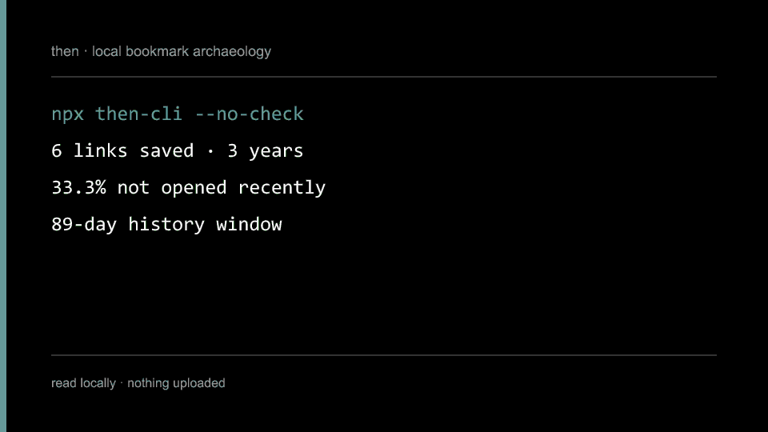

# then-cli

Your browser has a decade of bookmarks. It can give you folders and a flat list sorted by date, but it cannot answer what you saved in 2014, which of those links are still alive, or whether you ever went back to any of it.

`then` joins your Chromium bookmarks with your browser history and checks the links, so the archive stops being a graveyard you are afraid to open.



## Install

```bash
npx then-cli --no-check
```

Or install it:

```bash
npm install -g then-cli
then --no-check
```

## What you get

- **A private report.** `then-out/report.html` — header stats, a timeline by year, a graveyard of dead links, a regret queue, and one page per year. It opens itself when you run `then` from a terminal.
- **A card.** `then card` writes `then-out/card.png` and `then-out/card.svg`. Counts, domains, and years only, never URLs.
- **A rescue file.** `then rescue --write` writes `then-out/rescued-bookmarks.html`, importable by Chrome, Edge, and Brave.

## Commands

```bash
then                        # report, default profile
then --year 2014            # open the report at 2014
then --no-check             # offline, instant
then --redact               # strip full URLs from the report
then --profile <name|path>  # choose a profile when several exist
then card                   # write then-out/card.png + card.svg
then rescue --dry-run       # list recoverable dead links
then rescue --write         # write then-out/rescued-bookmarks.html
then --help                 # show this message
```

## The graveyard

Dead links are grouped by the year you saved them, with the domains you lost most often. A 403 or 429 is a bot wall, not link rot, so those links are labeled blocked instead of dead.

## The regret queue

Living links you have not opened recently, oldest save first. It is a prompt to look again, not a claim about intent.

## The card

`then card` renders a 1080x1350 PNG plus an SVG and a 1200x630 Open Graph variant. It shows totals, dead and unopened percentages, the top domain of your earliest year, and six domain tiles with initials. It never contains full URLs, titles, or folder names.

## Privacy

Everything runs locally. The only outbound requests are link checks and Wayback availability lookups. There is no telemetry, no analytics, no crash reporting, and no update check.

Output lives in `then-out/`, which contains a `.gitignore` with `*` so a report cannot be committed by accident. `--redact` removes full URLs from the report. The card never contains URLs, titles, or folder names.

This file knows more about you than your browser history. Do not commit it.

## Limitations

- Chromium only in v0: Chrome, Edge, and Brave. Firefox and Safari are not read.
- Chrome trims its history. The report shows the retained window, and labels say "not opened in the last N days" rather than "never opened" when the save falls outside that window.
- Link checks depend on the target site. A site that blocks bots will report blocked, not dead.
- No telemetry. Retention is not measured, and there is no hidden dashboard behind that choice.

## Development

```bash
npm ci
npm run build
npm test
node scripts/verify.mjs      # report, artifacts, privacy, layout checks
```

## License

MIT
